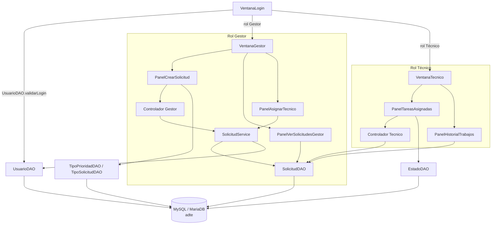
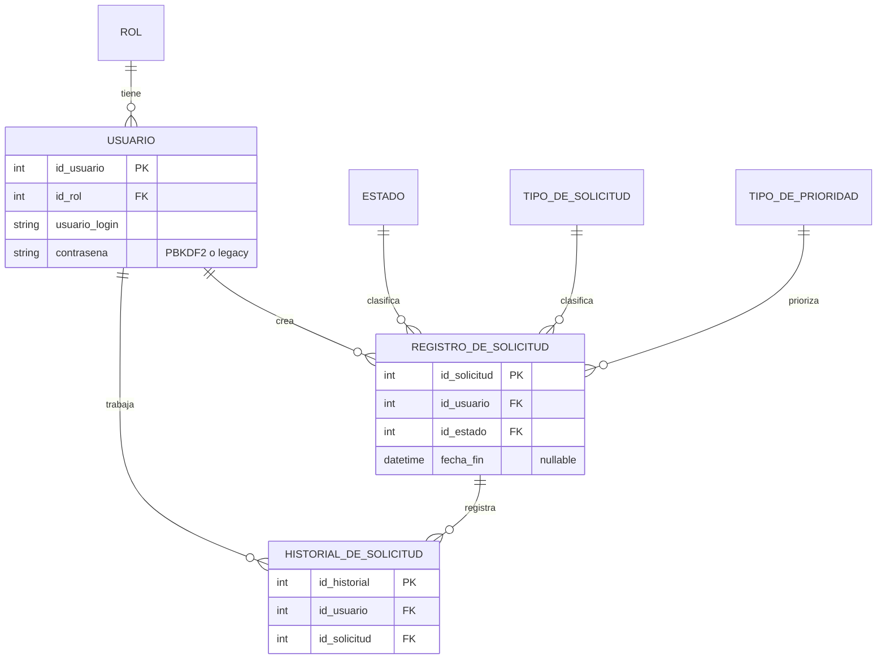
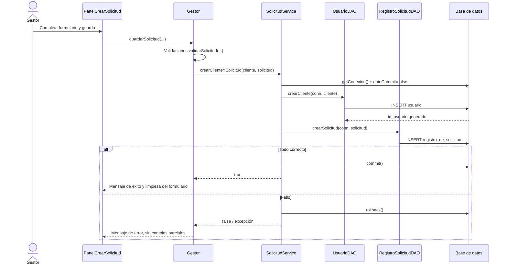
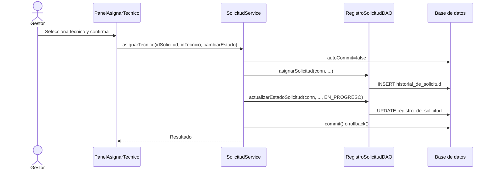

# Arquitectura

El proyecto conserva una arquitectura en capas sencilla, típica de un trabajo universitario de Java Swing: **vista → controlador/servicio → DAO → base de datos**. Las mejoras se hicieron sin cambiar ese modelo.

## Vista general

## Responsabilidades por paquete

| Paquete | Responsabilidad |
| --- | --- |
| `l2madevs.config` | Leer URL, usuario y contraseña desde propiedades del sistema o variables de entorno. |
| `l2madevs.modelo` | POJOs (`Usuario`, `Rol`, `RegistroSolicitud`, `Estado`, `TipoSolicitud`, `TipoPrioridad`). |
| `l2madevs.dao` | Sentencias SQL, mapeo `ResultSet` → modelo y manejo de `Connection`. |
| `l2madevs.seguridad` | Hash PBKDF2-HMAC-SHA256 y verificación de contraseñas. |
| `l2madevs.util` | Constantes de catálogos y validaciones puras sin dependencia de Swing. |
| `l2madevs.servicio` | Operaciones que necesitan transacción (crear solicitud, asignar técnico). |
| `l2madevs.controlador` | Coordinación entre vista y datos; diálogos de confirmación. |
| `l2madevs.vista` | Ventanas, paneles y componentes Swing. Las consultas se hacen en `SwingWorker`. |
| `l2madevs.vista.base` | Panel abstracto compartido por las listas de gestor y técnico. |

## Modelo de datos

## Transacción: crear cliente y solicitud

Antes se insertaban el cliente y la solicitud con dos conexiones: si fallaba la segunda, quedaba un cliente huérfano. Ahora `SolicitudService` abre una sola conexión, desactiva `autoCommit` y hace rollback ante cualquier fallo.

## Transacción: asignar técnico

## Concurrencia e interfaz

- Las consultas a BD se envuelven con `VistaUtils.enSegundoPlano`, que usa `SwingWorker<Void>`:
  - `doInBackground()`: ejecuta la consulta fuera del EDT.
  - `done()`: actualiza los componentes de Swing en el EDT y muestra errores con `JOptionPane`.
- Las listas de solicitudes comparten `PanelMostrarSolicitudes`; cada rol implementa `obtenerDatosFuente()` y `crearPanelAccionesEstado()`.
- El historial ya no depende de una lista en memoria: se consulta por `id_usuario` en `historial_de_solicitud` y se filtra por `id_estado = 3` (Finalizado).

## Seguridad

- `PasswordHasher` guarda `PBKDF2$iteraciones$salt$hash` en base64, con 120.000 iteraciones HMAC-SHA256 y salt aleatorio de 16 bytes.
- `UsuarioDAO.validarLogin` detecta valores `PBKDF2$...` y, si encuentra texto plano, verifica la contraseña antigua y la reemplaza por un hash.
- Las credenciales de conexión a BD no están en el código; se leen desde `Configuracion`.

## Pruebas

Las pruebas JUnit 4 se centran en lógica pura y seguridad, sin requerir base de datos: validaciones, hash de contraseñas e igualdad de entidades. `scripts\probar.bat` compila y ejecuta las tres clases de test.
